# LOGENT / InventorySaaS


LOGENT es una plataforma SaaS multiempresa para gestión de inventario. Permite administrar empresas, usuarios, roles, productos, almacenes, stock, movimientos, Kardex, reportes, auditoría, notificaciones, configuración de empresa y planes de suscripción en modo demo.

InventorySaaS es el nombre técnico del repositorio/proyecto. LOGENT es la marca visible del producto.

## Demo Online

- Frontend demo: [https://logent.vercel.app](https://logent.vercel.app)
- Backend demo: [https://logent-api.onrender.com](https://logent-api.onrender.com)
- Healthcheck: [https://logent-api.onrender.com/health](https://logent-api.onrender.com/health)

## Aviso Demo/Portafolio

LOGENT es un proyecto profesional de portafolio/demo. No es un sistema comercial en producción real.

- Stripe está configurado en modo test.
- No se usan cobros reales.
- No se publican contraseñas, claves, cadenas de conexión ni secretos.
- Las credenciales de acceso demo están disponibles bajo solicitud.
- La pantalla de login puede incluir acceso demo para evaluación rápida.

## Capturas

### Landing y Login

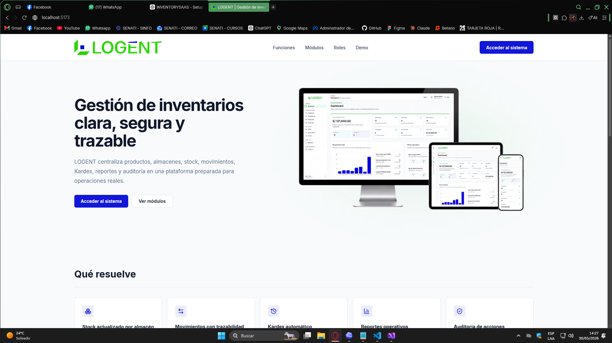

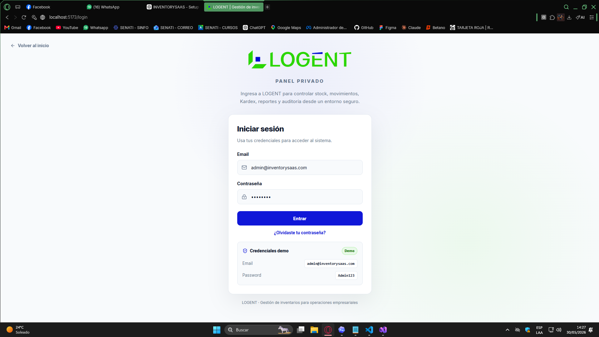

### Dashboard

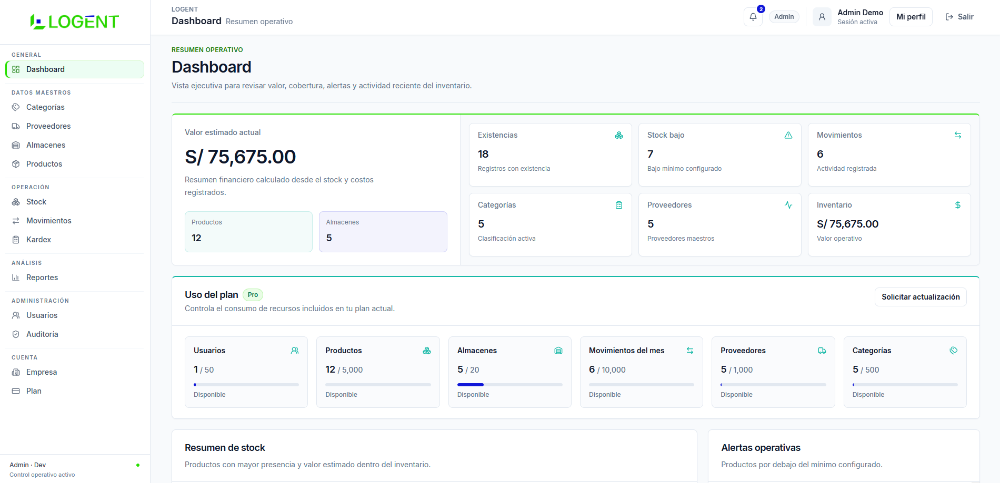

### Inventario

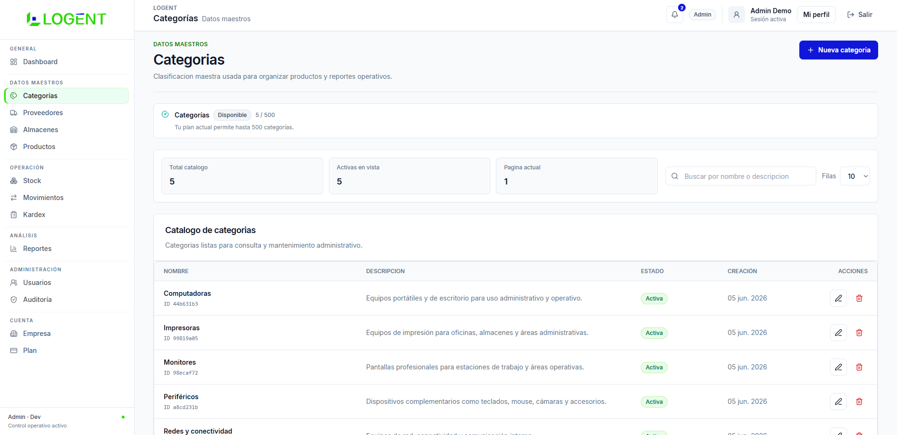

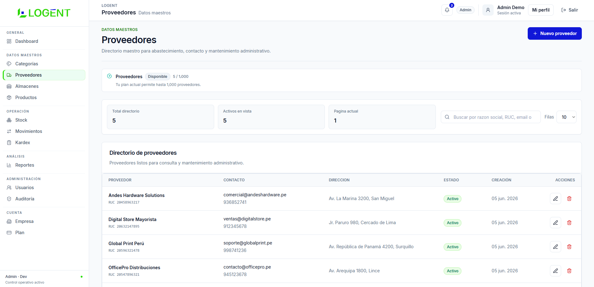

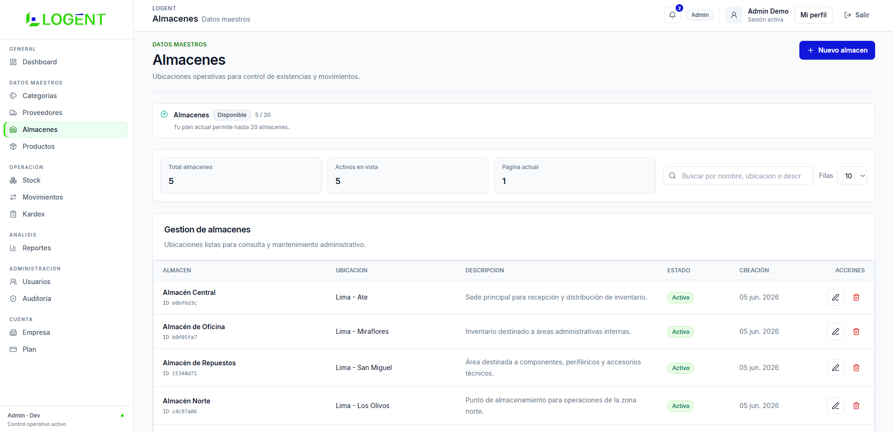

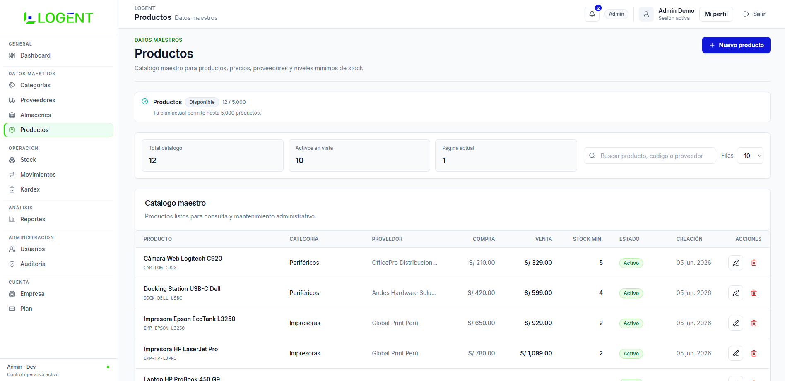

### Operación

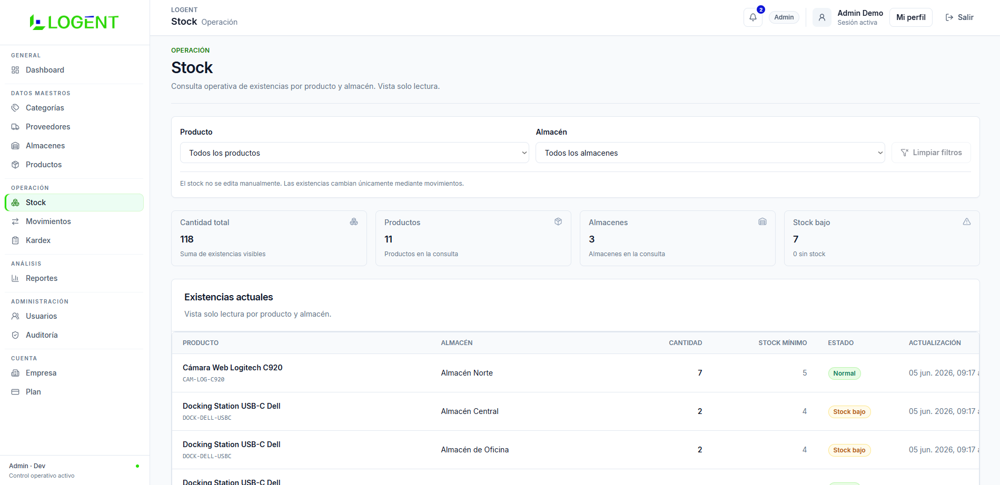

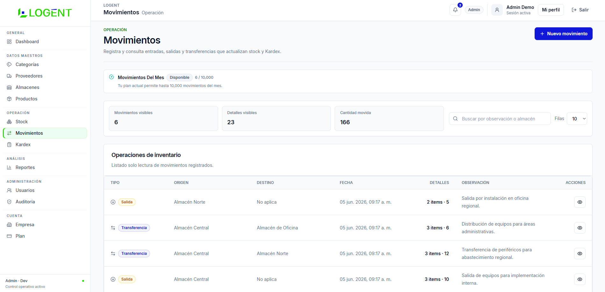

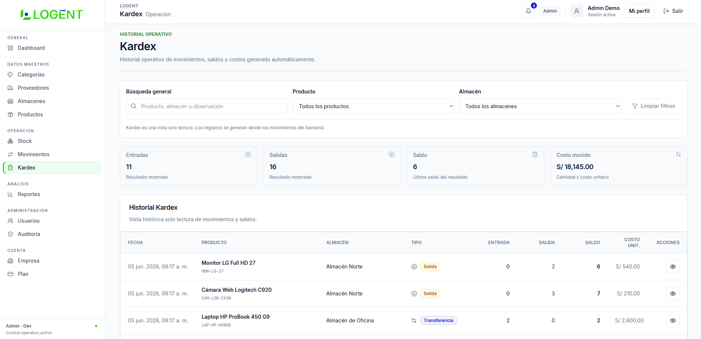

### Análisis

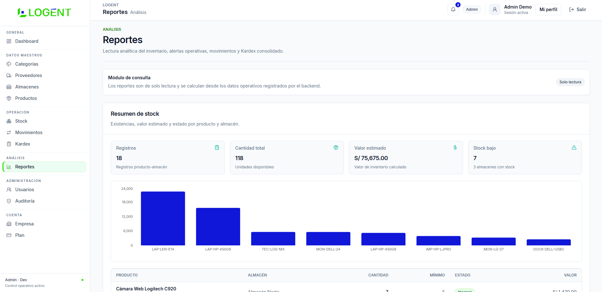

### Administración

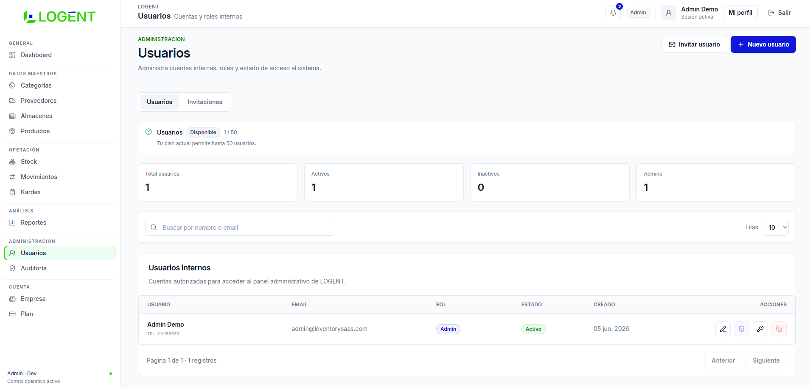

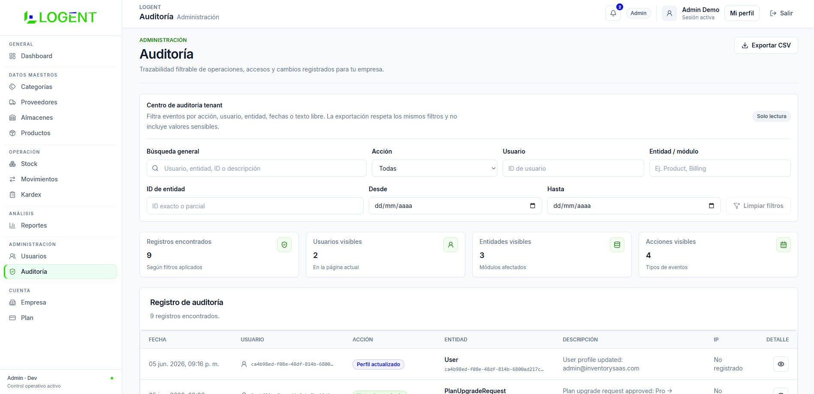

### Cuenta y Empresa

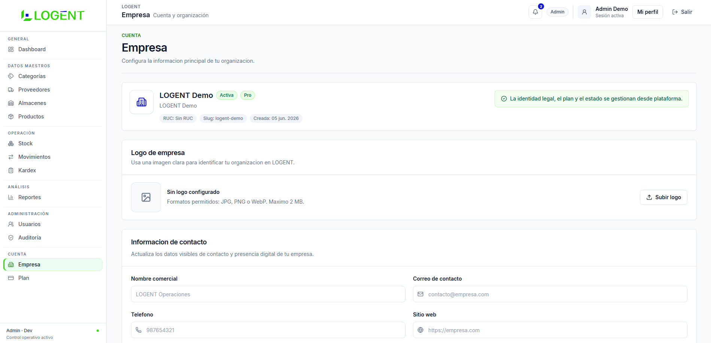

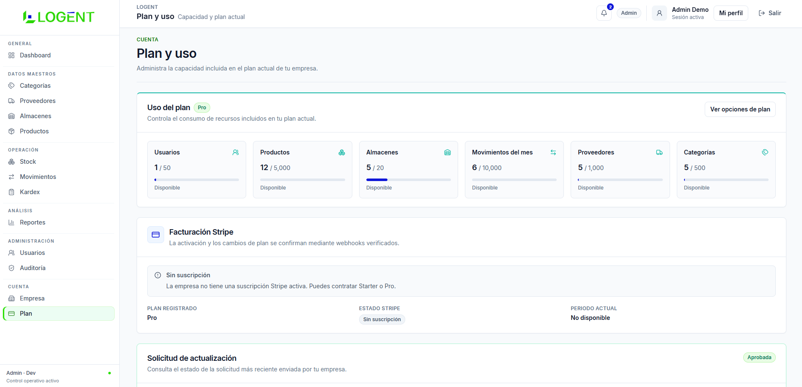

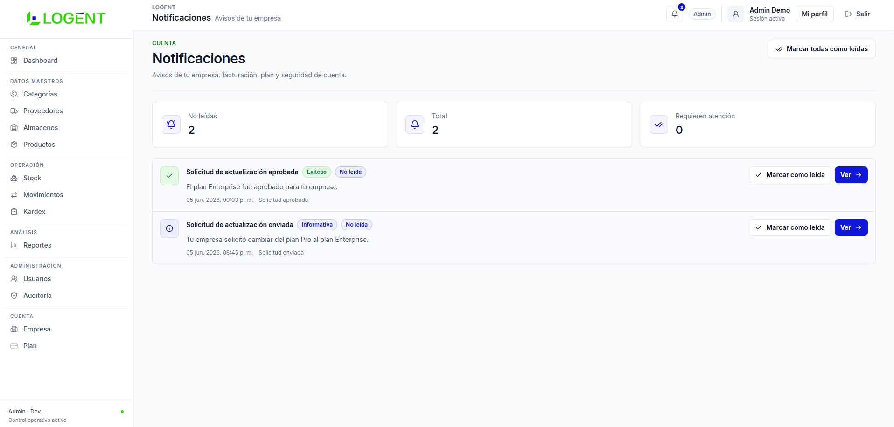

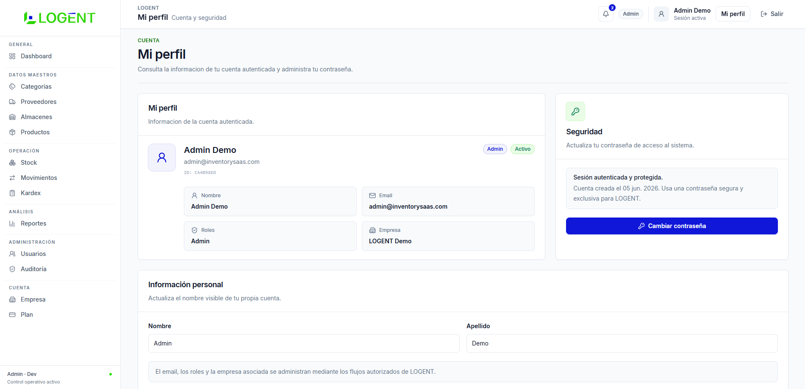

### Estados

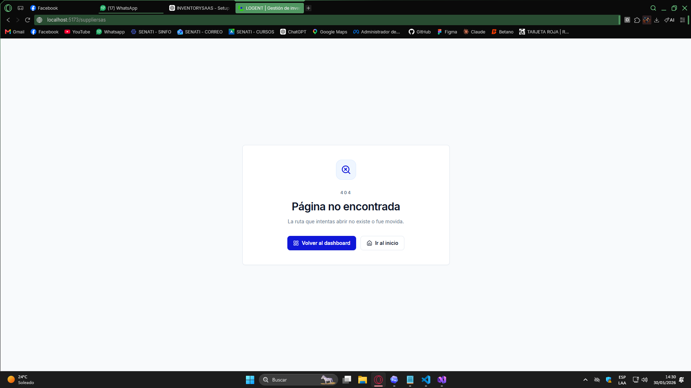

## Stack Técnico

### Backend

- ASP.NET Core Web API .NET 10
- Entity Framework Core
- SQL Server / Azure SQL
- ASP.NET Core Identity
- JWT Bearer
- Clean Architecture
- FluentValidation
- Serilog
- Rate limiting, CORS y security headers

### Frontend

- React
- Vite
- TypeScript
- Tailwind CSS
- React Router
- TanStack Query
- Axios
- React Hook Form
- Zod
- Recharts
- Lucide React
- Sonner

### Integraciones

- Stripe en modo test
- Cloudinary para logos de empresa
- SMTP/Brevo o SMTP demo controlado
- Azure SQL
- Render
- Vercel

## Arquitectura General

El backend sigue Clean Architecture y separa dominio, casos de uso, infraestructura y API HTTP.

```text
backend/
├── InventorySaaS.Domain
├── InventorySaaS.Application
├── InventorySaaS.Infrastructure
└── InventorySaaS.WebApi
```

El frontend está organizado por features y componentes compartidos.

```text
frontend/
└── src/
    ├── app
    ├── assets
    ├── components
    ├── features
    ├── lib
    └── types
```

La aplicación usa API REST, autenticación JWT, control de acceso por roles, aislamiento por tenant y reglas de inventario aplicadas desde backend.

Más detalle en [docs/architecture.md](docs/architecture.md).

## Módulos Implementados

- Landing pública LOGENT.
- Registro de empresa con confirmación de email.
- Login privado.
- Recuperación y cambio de contraseña.
- Dashboard tenant.
- Gestión de categorías.
- Gestión de proveedores.
- Gestión de almacenes.
- Gestión de productos.
- Consulta de stock por producto y almacén.
- Movimientos de entrada, salida y transferencia.
- Kardex automático.
- Reportes operativos.
- Auditoría tenant filtrable y exportable.
- Gestión de usuarios tenant.
- Invitaciones por correo.
- Configuración de empresa y logo.
- Planes, uso y límites.
- Stripe Checkout test y Customer Portal test.
- Notificaciones internas tenant.
- Emails transaccionales para eventos críticos.
- Dashboard y módulos SuperAdmin de plataforma.
- Páginas 403 y 404.

## Flujo SaaS Multiempresa

1. Una empresa se registra desde el flujo público.
2. El primer usuario queda asociado a la empresa como Admin.
3. El correo debe confirmarse antes de iniciar sesión.
4. Cada usuario pertenece a una empresa mediante `CompanyId`.
5. Las consultas y operaciones se filtran por tenant.
6. El Admin tenant gestiona usuarios e invitaciones de su empresa.
7. Los datos de inventario, auditoría, reportes, notificaciones y configuración quedan aislados por empresa.
8. SuperAdmin opera la plataforma desde módulos separados.

## Seguridad

- Autenticación con JWT.
- Roles: SuperAdmin, Admin, Almacenero y Consulta.
- Aislamiento por tenant/empresa.
- Confirmación de correo.
- Recuperación de contraseña.
- Cambio de contraseña autenticado.
- Rate limiting en endpoints sensibles.
- CORS configurado por ambiente.
- Security headers.
- Validaciones con FluentValidation.
- Respuestas de error estandarizadas.
- Auditoría de acciones relevantes.
- Bloqueo de empresa suspendida.
- Enforcement de suscripción y límites por plan.
- No se exponen hashes de contraseña, tokens, secretos ni claves de proveedor.

## Reglas De Inventario

- El stock no se edita manualmente.
- El stock cambia mediante movimientos.
- Una entrada aumenta stock.
- Una salida reduce stock y valida disponibilidad.
- Una transferencia descuenta del almacén origen y suma al almacén destino.
- Kardex, reportes y auditoría son de solo lectura.

## Acceso Demo

Credenciales disponibles bajo solicitud.

La pantalla de login puede incluir un acceso demo para evaluación rápida. El entorno demo no debe usarse con datos reales.

Guía breve: [docs/demo-guide.md](docs/demo-guide.md).

## Instalación Local

### Requisitos

- .NET SDK 10
- Node.js
- npm
- SQL Server o SQL Server Express
- Git
- Opcional: MailPit, Stripe CLI y cuenta Cloudinary de prueba

### Backend

```bash
cd backend
dotnet restore
dotnet build
dotnet ef database update --project InventorySaaS.Infrastructure --startup-project InventorySaaS.WebApi
dotnet run --project InventorySaaS.WebApi/InventorySaaS.WebApi.csproj --launch-profile http --urls http://localhost:5088
```

API local:

```text
http://localhost:5088
```

Healthcheck local:

```text
http://localhost:5088/health
```

### Frontend

```bash
cd frontend
npm install
npm run dev
```

Frontend local:

```text
http://localhost:5173
```

## Variables De Entorno

Configurar mediante User Secrets, variables de entorno del proveedor o archivos `.env` locales no versionados. No incluir valores reales en el repositorio.

```text
ConnectionStrings__DefaultConnection
Jwt__Key
Jwt__Issuer
Jwt__Audience
Cors__AllowedOrigins__0
AppUrls__FrontendBaseUrl
Stripe__PublishableKey
Stripe__SecretKey
Stripe__WebhookSecret
Stripe__StarterPriceId
Stripe__ProPriceId
Cloudinary__CloudName
Cloudinary__ApiKey
Cloudinary__ApiSecret
EmailSettings__Host
EmailSettings__Port
EmailSettings__UserName
EmailSettings__Password
EmailSettings__FromEmail
EmailSettings__FromName
EmailSettings__EnableSsl
```

Frontend:

```text
VITE_API_URL
```

## Despliegue Demo

Arquitectura demo actual:

- Frontend: Vercel.
- Backend: Render.
- Base de datos: Azure SQL.
- Stripe: test mode.
- Cloudinary: cuenta/carpeta de prueba.
- Email: SMTP demo/controlado.

Documentación de despliegue: [docs/deployment-demo.md](docs/deployment-demo.md).

## Roadmap

- Clientes.
- Ventas/POS.
- Comprobantes internos.
- Promociones y descuentos.
- Más analítica operativa y de plataforma.
- Mejoras de monitoreo para demo pública.

## Estado Del Proyecto

- QA final funcional completado.
- Demo seed funcional cargado.
- Sistema desplegado como demo online.
- README de portafolio actualizado.

## Autor

Desarrollado por Luis Ángel Rodríguez Guevara.

Proyecto full-stack avanzado para portafolio profesional.
