# LOGENT / InventorySaaS

Sistema web de gestión de inventarios con control de stock, movimientos, Kardex, reportes, auditoría y administración interna de usuarios.

LOGENT es la identidad visual del producto. InventorySaaS es el nombre técnico del repositorio y del proyecto.

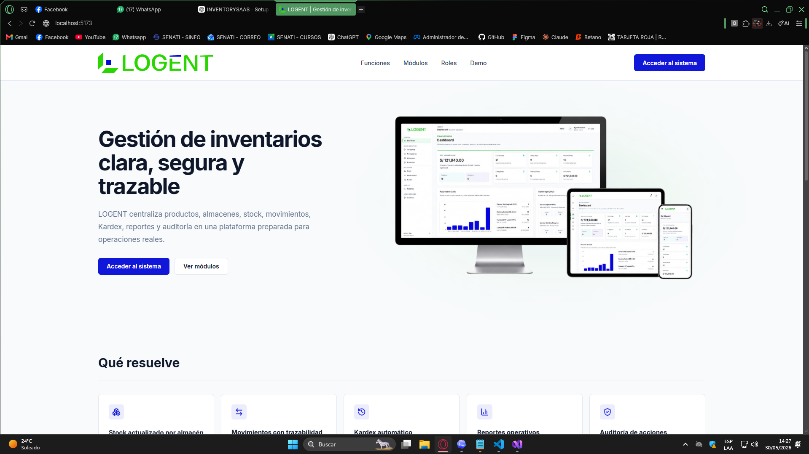

## Problema Que Resuelve

LOGENT centraliza la operación de inventario en una plataforma clara para administrar productos, proveedores, almacenes, stock por ubicación, movimientos y trazabilidad operativa.

El sistema evita la edición manual del stock y mantiene el historial mediante movimientos controlados, Kardex automático, reportes de solo lectura y auditoría administrativa.

## Características Principales

- Landing pública de presentación.
- Login privado con autenticación JWT.
- Dashboard operativo.
- Gestión de categorías.
- Gestión de proveedores.
- Gestión de almacenes.
- Gestión de productos.
- Stock por producto y almacén.
- Movimientos de entrada, salida y transferencia.
- Kardex automático.
- Reportes operativos.
- Auditoría de acciones.
- Gestión interna de usuarios y roles.
- Perfil del usuario autenticado.
- Páginas 403 y 404.
- Seed demo profesional para ambiente local.

## Reglas De Negocio

- El stock no se edita manualmente.
- El stock cambia únicamente mediante movimientos.
- Una entrada aumenta stock en el almacén destino.
- Una salida disminuye stock y valida existencia suficiente.
- Una transferencia mueve stock entre almacenes.
- El Kardex se genera automáticamente desde movimientos.
- Los reportes son de solo lectura.
- La auditoría es de solo lectura.
- Los usuarios se crean internamente por un usuario Admin.

## Flujo De Acceso

```text
/              Landing pública
/login         Acceso privado
/dashboard     Panel principal
/admin/users   Gestión de usuarios, solo Admin
/profile       Perfil del usuario autenticado
/unauthorized  Acceso no autorizado
*              Página no encontrada
```

## Registro Público

LOGENT no utiliza registro público abierto. Los usuarios son gestionados por un administrador, quien crea las cuentas internas y asigna roles según el nivel de acceso operativo.

## Roles

- **Admin:** acceso completo, gestión de usuarios, auditoría, datos maestros, operación y reportes.
- **Almacenero:** operación diaria, consulta de stock, registro de movimientos y revisión de Kardex según permisos configurados.
- **Consulta:** acceso de lectura para supervisión, stock, Kardex y reportes según permisos configurados.

## Stack Técnico

### Backend

- ASP.NET Core Web API
- Entity Framework Core
- SQL Server
- ASP.NET Core Identity
- JWT
- Clean Architecture
- FluentValidation
- Auditoría interna

### Frontend

- React
- Vite
- TypeScript
- Tailwind CSS
- React Router
- TanStack Query
- Axios
- React Hook Form
- Zod
- Recharts
- Lucide React
- Sonner

## Arquitectura

El backend está separado por capas siguiendo Clean Architecture. La solución diferencia dominio, aplicación, infraestructura y API HTTP.

```text
backend/
├── InventorySaaS.Domain
├── InventorySaaS.Application
├── InventorySaaS.Infrastructure
└── InventorySaaS.WebApi
```

El frontend está organizado por features, con componentes compartidos, clientes API, tipos y páginas por módulo.

```text
frontend/
└── src/
    ├── app
    ├── components
    ├── features
    ├── lib
    └── types
```

La comunicación se realiza mediante API REST. La autenticación usa JWT, con rutas protegidas y control de acceso por roles.

## Módulos Principales

- **Dashboard:** resumen operativo de inventario, alertas y actividad reciente.
- **Categorías:** administración de clasificaciones de productos.
- **Proveedores:** administración de proveedores y datos comerciales.
- **Almacenes:** administración de ubicaciones de inventario.
- **Productos:** catálogo maestro con precios, stock mínimo, categoría y proveedor.
- **Stock:** consulta de existencias por producto y almacén.
- **Movimientos:** registro de entradas, salidas y transferencias.
- **Kardex:** historial automático y solo lectura de movimientos.
- **Reportes:** vistas operativas de stock, stock bajo, movimientos y Kardex.
- **Auditoría:** trazabilidad administrativa de acciones relevantes.
- **Usuarios:** administración interna de cuentas, roles y estado de acceso.
- **Perfil:** consulta de cuenta y cambio de contraseña del usuario autenticado.

## Capturas

### Landing pública


### Login

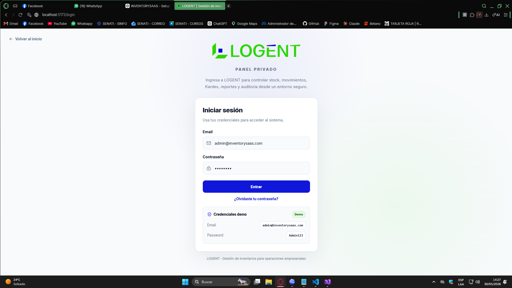

### Dashboard

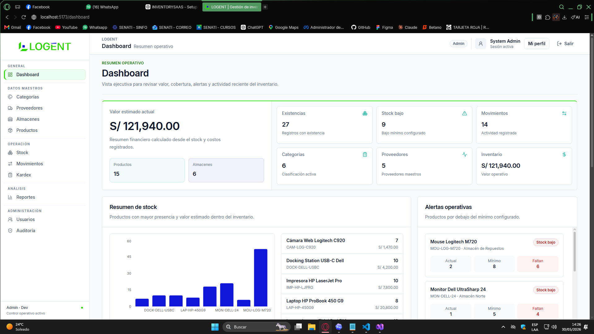

### Productos

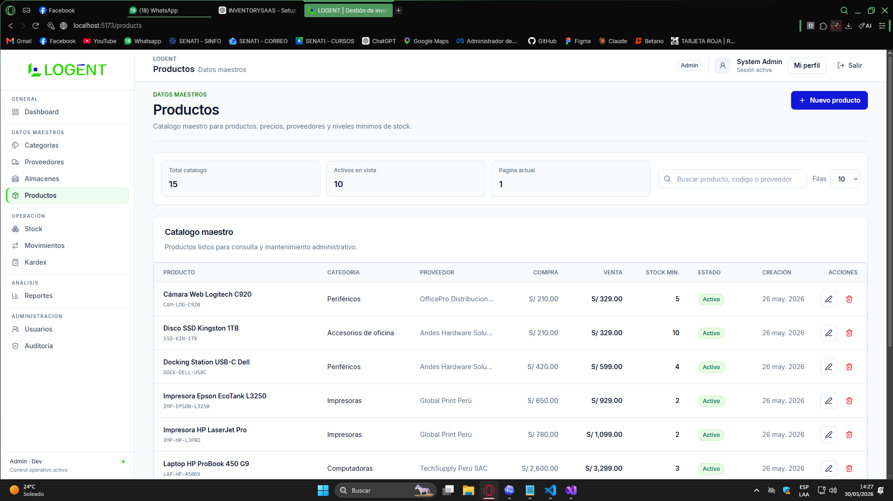

### Stock

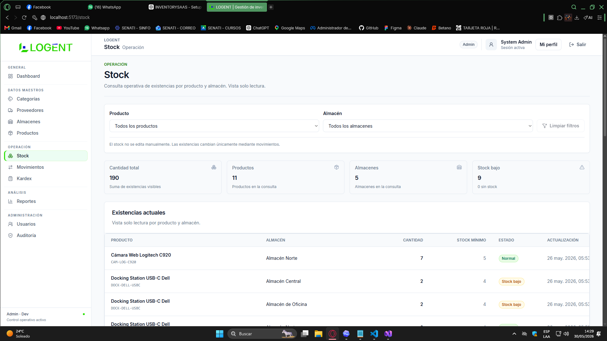

### Movimientos

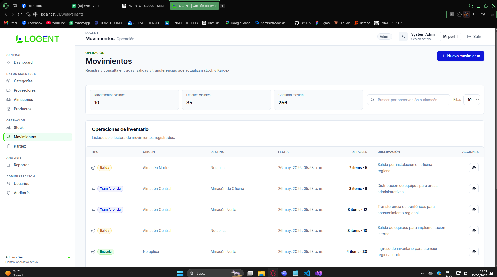

### Kardex

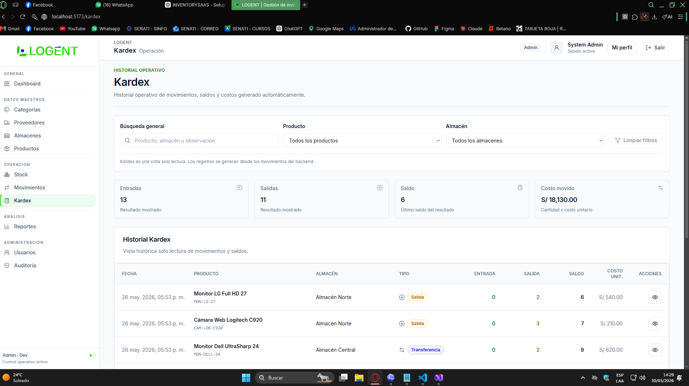

### Reportes

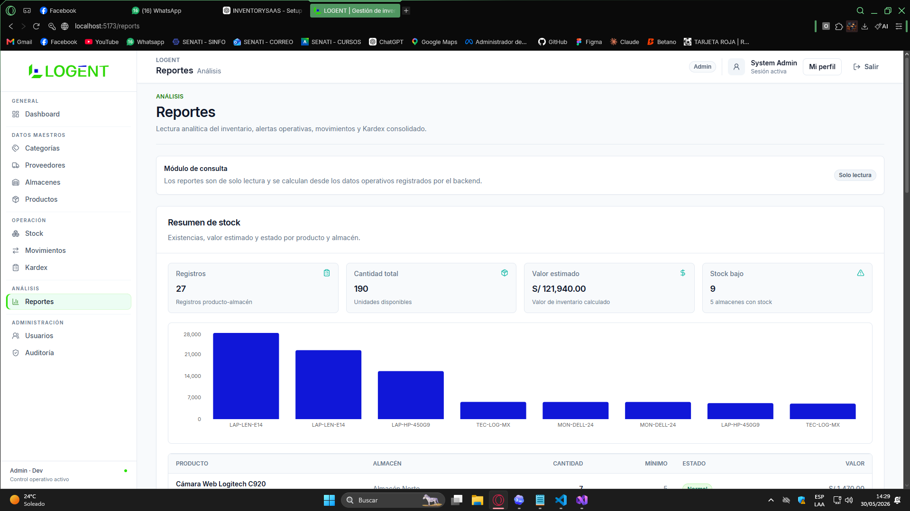

### Usuarios y roles

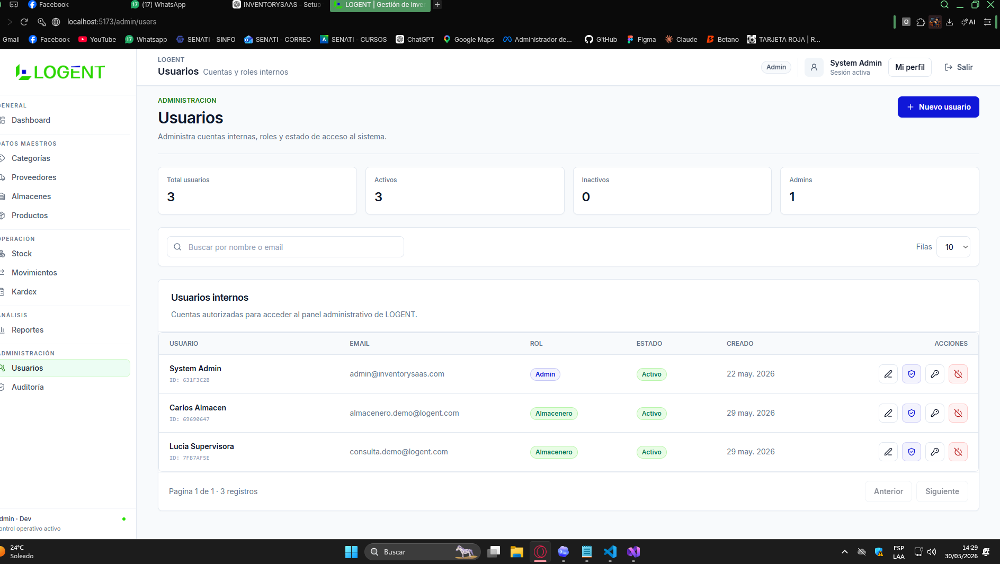

### Perfil

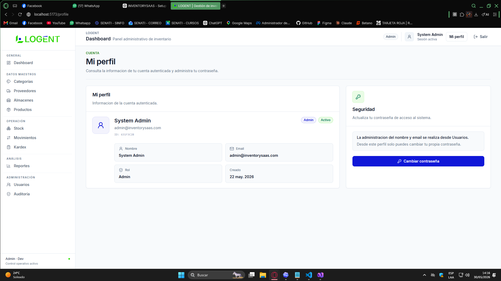

### Auditoría

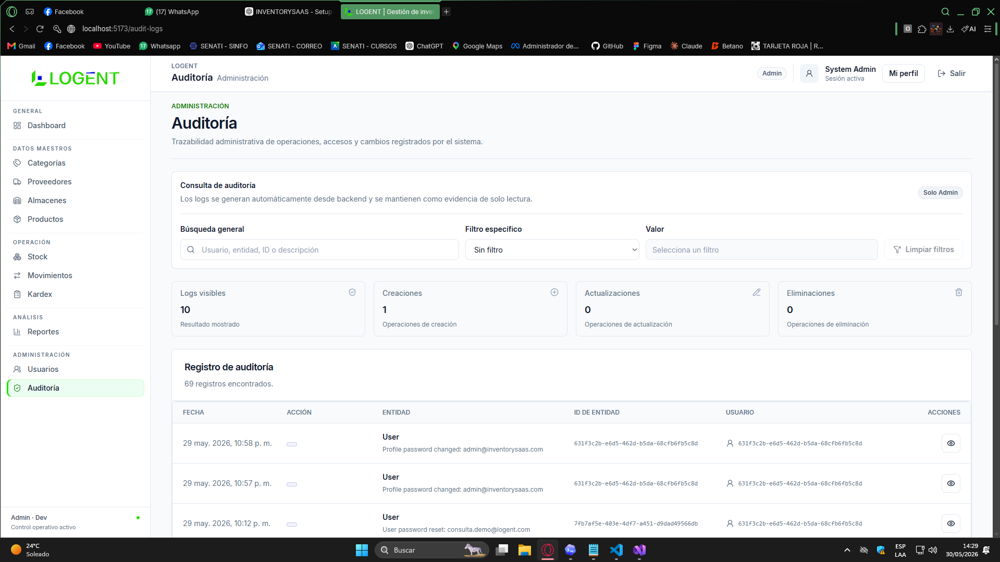

### Categorías

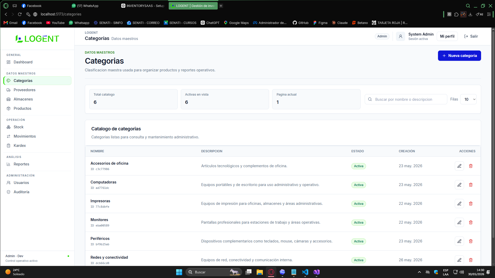

### Proveedores

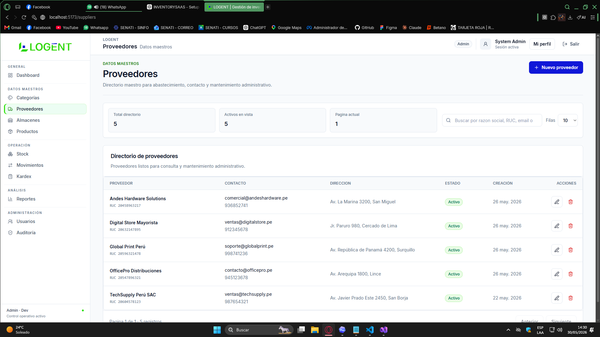

### Página no encontrada


## Credenciales Demo

```text
Email: admin@inventorysaas.com
Password: Admin123
```

Credenciales solo para ambiente local/demo.

## Requisitos Previos

- .NET SDK
- Node.js
- npm
- SQL Server o SQL Server Express
- Git

## Instalación Y Ejecución

### Backend

Desde la raíz del proyecto:

```bash
cd backend
dotnet restore
dotnet build
dotnet run --project InventorySaaS.WebApi/InventorySaaS.WebApi.csproj --launch-profile http --urls http://localhost:5088
```

La API queda disponible en:

```text
http://localhost:5088
```

Swagger queda disponible en:

```text
http://localhost:5088/swagger
```

### Frontend

Desde la raíz del proyecto:

```bash
cd frontend
npm install
npm run dev
```

El frontend queda disponible en:

```text
http://localhost:5173
```

## Seed Demo Profesional

El sistema incluye un `DemoDataSeeder` para ambiente local/demo.

- Se ejecuta automáticamente en Development.
- Es idempotente.
- Evita duplicar datos demo.
- Crea categorías, proveedores, almacenes, productos y movimientos demo.
- El stock se genera mediante la lógica de movimientos.
- El Kardex se genera automáticamente desde los movimientos.

## Endpoints Principales

### Auth y perfil

```text
POST /api/auth/login
GET  /api/auth/me
GET  /api/profile
PUT  /api/profile/password
```

### Dashboard

```text
GET /api/dashboard/summary
GET /api/dashboard/stock-overview
GET /api/dashboard/recent-movements
GET /api/dashboard/low-stock-alerts
```

### Catálogos

```text
/api/categories
/api/suppliers
/api/warehouses
/api/products
```

### Operación

```text
/api/stock-items
/api/movements
/api/kardex
```

### Reportes

```text
GET /api/reports/stock-summary
GET /api/reports/low-stock
GET /api/reports/movements-summary
GET /api/reports/kardex-summary
```

### Administración

```text
/api/users
/api/audit-logs
```

## Estado Del Proyecto

Proyecto funcional para portafolio. Incluye backend, frontend, autenticación, roles, reglas de stock, Kardex, reportes, auditoría, gestión de usuarios y una UI responsive con identidad LOGENT.

Pendiente opcional:

- Deploy.
- Documentación Swagger ampliada.
- Exportación de reportes si se decide implementar en el futuro.

## Autor

Luis Ángel Rodríguez Guevara  
Proyecto de portafolio full-stack.
